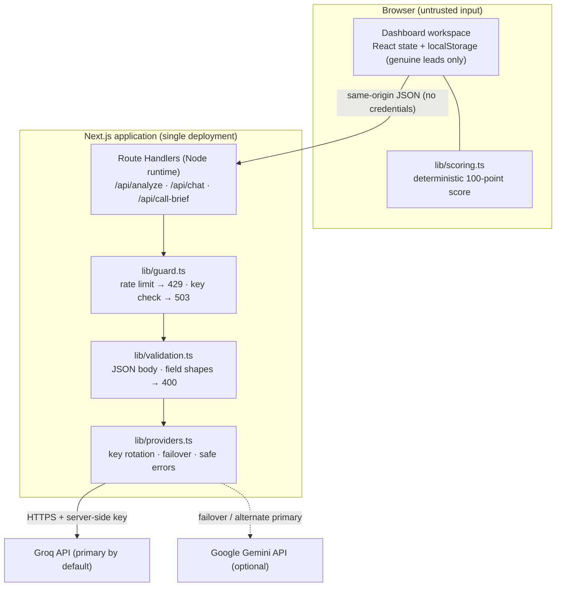

# masal.ai

> An AI sales copilot for residential real estate that turns a raw property enquiry into a prioritised, explained lead — with a recommended next action, a ready-to-send reply, and a call brief before you pick up the phone.

**[Live demo](https://assignment-masal.vercel.app)** · **[Repository](https://github.com/ANUBprad/masal-ai-assignment)** · **[Architecture](docs/ARCHITECTURE.md)** · **[Decisions](docs/decisions.md)** · **[Production audit](docs/PRODUCTION_AUDIT.md)**


---

## Product demo

**[Watch the product demo on Google Drive](https://drive.google.com/file/d/1ovpBG_bRJm6eGX8FIQjZtlP0-Mcx9PyD/view?usp=sharing)**

A short screen-recorded walkthrough of the end-to-end workflow: capturing and managing leads, running the AI analysis and reviewing the grounded suggested reply, reading the deterministic priority score and its breakdown, generating a Call Brief, and asking the Sales Copilot a custom question.

Try it live: [assignment-masal.vercel.app](https://assignment-masal.vercel.app) · Source: [github.com/ANUBprad/masal-ai-assignment](https://github.com/ANUBprad/masal-ai-assignment)

> Access note: the video is hosted on Google Drive. If the link does not open, the file's sharing setting must allow "Anyone with the link" so reviewers can view it. This repository cannot itself verify that the Drive link is publicly accessible.

---

## Table of contents

- [Product demo](#product-demo)
- [The problem and the solution](#the-problem-and-the-solution)
- [Feature overview](#feature-overview)
- [Demo walkthrough](#demo-walkthrough)
- [Lead scoring explained](#lead-scoring-explained)
- [Architecture](#architecture)
- [Technology stack](#technology-stack)
- [Local setup](#local-setup)
- [Testing and CI](#testing-and-ci)
- [AI usage disclosure](#ai-usage-disclosure)
- [Privacy, security, and limitations](#privacy-security-and-limitations)
- [Design decisions and future improvements](#design-decisions-and-future-improvements)

---

## The problem and the solution

Real-estate sales teams receive enquiries that are noisy, incomplete, and hard to compare. A ready buyer and a curious browser arrive in the same inbox, and the signals that decide who to call first — budget, timeline, financing, a request to visit — are buried in free text. Reps lose time re-reading messages and guessing.

masal.ai gives a salesperson one focused workspace that turns each enquiry into:

1. **A deterministic priority** — a transparent, testable 100-point score that says who to work first, with the evidence and the missing qualification details shown alongside it.
2. **An AI analysis** — a summary, intent, requirements, objections, a recommended next action, and a suggested reply, grounded only in the lead's own details.
3. **A ready-to-send reply** — drafted for the salesperson to review, edit, and send.
4. **A call brief** — objective, opening line, talking points, qualifying questions, and risks to watch, generated before the call.
5. **An interactive copilot** — per-lead follow-up questions answered in context, with the analysis and recent conversation available to it.

The two halves are kept deliberately separate: a small rules engine decides *who to work first*, while the LLM does the *language-heavy* work (intent, objections, drafting). The model never scores a lead. This app is a focused demonstration of that design, not a production CRM — see [Design decisions and future improvements](#design-decisions-and-future-improvements).

## Feature overview

| Feature | What it does |
| --- | --- |
| **Lead capture and management** | A six-field intake form (name, location, property requirement, budget, timeline, message) with per-field validation. Leads are stored per browser and can be searched, filtered by priority, and removed. |
| **AI analysis and grounded suggested replies** | A one-shot analysis returns a summary, intent, key requirements, objections/concerns, a recommended next action, and a suggested reply. It also separates **known facts**, **inferences**, **unknowns**, and **deal risks** so confirmed information is not confused with interpretation. |
| **Explainable deterministic scoring** | A fixed five-dimension rubric produces the score and the `Act Now` / `Follow Up` / `Nurture` label, with a per-dimension breakdown, positive signals, and the missing information. See [Lead scoring explained](#lead-scoring-explained). |
| **Call Brief** | The chosen extra feature: a dedicated server route generates a compact pre-call prep sheet (objective, opening line, talking points, qualifying questions, watch-outs) from the same lead context, signed with one canonical salesperson identity (`Anubhab Pradhan` from `masal.ai`, defined once in `lib/site.ts`) so customer-facing copy never shows a placeholder. |
| **Custom-question Sales Copilot** | Ask anything about the selected lead; the answer is grounded in that lead's fields, its analysis, its score/priority, and the recent conversation. Chat is stored per lead. |
| **Pipeline status and demo leads** | Track each lead through `New → Contacted → Visit scheduled → Qualified → Closed`. Three clearly labelled demo scenarios (one per priority band) show the workspace end to end and can be removed in one click. |

## Demo walkthrough

A short reviewer path through the workspace at [assignment-masal.vercel.app/dashboard](https://assignment-masal.vercel.app/dashboard):

1. **Open the dashboard.** It starts on a welcome state — no lead is auto-selected. The sidebar shows three **Sample scenarios** grouped separately from an empty **Your leads** list.
2. **Select a demo scenario.** Each one is labelled `(Dummy)`, and each lands in a different priority band, so you can see `Act Now`, `Follow Up`, and `Nurture` side by side.
3. **Read the assessment.** The selected-lead view shows the score ring, the priority, the recommended next action, the open questions, the known facts, and the deal risks. The **AI Analysis** tab holds the summary, intent, requirements, the suggested reply (with a copy button), and the facts / inferences / unknowns / deal risks separation.
4. **Generate a Call Brief.** In the **Call Brief** tab, prepare a pre-call sheet grounded in the buyer's own details.
5. **Ask the copilot a custom question.** In the **Sales Copilot** tab, type a question about the lead — for example, *"How should I handle the pricing objection?"* or *"What should I ask next to qualify this lead?"* The answer is grounded in that lead's details, analysis, and recent conversation.
6. **Add a real lead.** Click **Add Lead**, fill the six fields, and submit. The app scores it deterministically and runs the AI analysis automatically (it can be refreshed). Your lead appears under **Your leads**.
7. **Work the pipeline.** Search, filter by priority, change a status, or remove a lead. Every lead keeps its own analysis, chat, and brief; switching between leads changes the context sent to the copilot.

**Dummy leads vs. your own leads.** The three scenarios are invented examples armed with a `demo: true` flag and a reserved `demo-` id. They are rebuilt from code on every load and are **never written to storage**, so they cannot duplicate or be mistaken for a real customer. Detection is by flag and id — never by name — so a genuine lead who happens to share a demo's name is never relabelled. Only records you create are persisted, under **Your leads**.

> The live URL is the documented deployment target. This repository cannot confirm that the running revision matches any particular commit; see [Deployment status](#deployment-status).

## Lead scoring explained

Scoring is **deterministic application logic** (`lib/scoring.ts`) and is never computed or overridden by the LLM. The same lead always produces the same score and breakdown, and missing information is reported rather than treated as a positive signal.

| Dimension | Max | What it reads (from recorded data only) |
| --- | ---: | --- |
| Buying timeline | 25 | The recorded timeline bucket (`Within 30 days` → 25, down to `Just exploring / no rush` → 0). LLM-stated urgency is not used. |
| Purchase intent | 25 | Independent, non-overlapping evidence signals in the customer message, summed with partial credit: explicit readiness (25) or a concrete booking/payment action (12); comparing/shortlisting (18) and booking can combine up to the 25 cap. General interest (10) and browsing (3) apply only when no strong signal is present, and browsing caps the score. Each phrase is counted once, and a negation in one clause does not mask a signal in another. |
| Requirement clarity | 20 | Four independently-scored components with partial credit: location; configuration (a stated size such as `3 BHK` scores higher than a bare type word); budget (a figure scores higher than a budget only discussed); and preferences/constraints. A property type alone never earns full clarity. |
| Budget readiness | 20 | Budget specificity (a specific figure, or a budget discussed but not quantified) plus explicit financing readiness (pre-approval, funds ready, etc.), scored as separate evidence. Missing financing is reported as unconfirmed and is never treated as financial weakness. |
| Engagement & commitment | 10 | Recorded status and the customer message are distinct evidence, summed and capped at 10: `Visit scheduled` → 10, `Qualified` → 5, plus a message-based confirmed next step (10) or a concrete next-step request (5). A negated next step ("I can't visit") earns nothing and is never assumed. |

**Priority bands:** `Act Now` **80–100** · `Follow Up` **50–79** · `Nurture` **0–49** (`priorityForScore`).

The score is a **prioritisation heuristic, not a probability of conversion and not a qualification status**. A high score means "work this lead sooner", not "this lead will close". The workspace shows the score out of 100, the priority label, and each dimension's earned/max alongside its supporting evidence or missing details, so the ranking is inspectable rather than opaque.

## Architecture

The browser owns the UI and all lead state; every credential and every AI call stays on the server. Requests are same-origin JSON with no credential headers.



- **Browser / `localStorage`.** `app/dashboard/page.tsx` is a client workspace that holds the `leads` array and persists genuine leads to `localStorage` (key `masal-ai-leads-v1`). Deterministic scoring runs here too. There is **no database and no multi-user persistence** — data is per-browser and per-device, and is lost when site data is cleared. The demo scenarios live in code, not storage.
- **API routes.** Three server Route Handlers (`runtime = "nodejs"`) are the only trusted boundary: `POST /api/analyze`, `POST /api/chat`, and `POST /api/call-brief`. They accept JSON and return `{ analysis }`, `{ answer }`, or `{ brief }` with `Cache-Control: no-store`.
- **Rate limiting and validation.** Each request passes `guard` (per-IP sliding window, then a provider-key check) and `lib/validation.ts` (JSON-object body, lead field lengths, timeline allow-list, chat question/history/analysis checks) before any prompt is built. Invalid input returns `400` without calling a provider.
- **Provider integration.** `lib/providers.ts` reads keys from the server environment, rotates numbered keys, calls Groq (OpenAI-compatible) or Gemini over `fetch` with a 45-second timeout, and fails over on retryable errors — returning only safe, generic error messages.
- **Prompt assembly.** `lib/prompts.ts` builds the context and the three system prompts, and a deterministic post-generation guard resolves identity placeholders and softens any unsupported availability/booking claim.

Full design, trust boundaries, the data model, the API contract, and sequence diagrams: **[docs/ARCHITECTURE.md](docs/ARCHITECTURE.md)**. Point-in-time decisions: [docs/decisions.md](docs/decisions.md). Security headers, SEO, and accessibility: [docs/PRODUCTION_AUDIT.md](docs/PRODUCTION_AUDIT.md).

## Technology stack

| Layer | Choice |
| --- | --- |
| Framework | Next.js 15 (App Router) + React 19 |
| Language | TypeScript 5 |
| Styling | Tailwind CSS 3, PostCSS, Autoprefixer; light and dark themes via CSS custom properties (light is the default) |
| Icons | `lucide-react` |
| AI providers | Groq (OpenAI-compatible `api.groq.com`) primary by default; Google Gemini (`generativelanguage.googleapis.com`) optional failover. Called directly with `fetch` — no SDK |
| Testing | Node.js built-in test runner (`node --test`) with TypeScript type stripping — no test-framework dependency |
| Linting | ESLint 9 with `eslint-config-next` |
| CI | GitHub Actions on Node 22 |

## Local setup

### Prerequisites

- **Node.js 22.6 or newer** (Node 22 LTS recommended). The test suite uses Node's built-in TypeScript type stripping (`--experimental-strip-types`, available from 22.6), so `npm test` will not run on older releases.
- npm.
- A **Groq API key** ([console.groq.com/keys](https://console.groq.com/keys)) for live AI calls. A Google Gemini key is optional.

### Install

```bash
npm ci
```

`npm ci` installs exactly from the committed `package-lock.json` for reproducible installs. Use `npm install` only if you are intentionally changing dependencies.

### Configure the environment

```bash
cp .env.example .env.local
# then edit .env.local and set GROQ_API_KEY=<your key>
```

### Run

```bash
npm run dev
```

Open <http://localhost:3000> for the landing page and <http://localhost:3000/dashboard> for the workspace. There is no in-app setup screen — the server reads keys from the environment. With no provider key configured, the UI still loads and AI actions return a clear "not configured" message.

### Environment variables

Read **server-side only** (`lib/providers.ts`; documented in `.env.example`). `GROQ_API_KEY`, `GROQ_API_KEY_2`… and `GEMINI_API_KEY` are secrets — set them in your local `.env.local` and in your host's environment settings; never commit them.

| Variable | Required | Purpose |
| --- | --- | --- |
| `GROQ_API_KEY` | Yes (default setup) | Server-side Groq key used for AI calls. |
| `AI_PROVIDER` | No | `groq` (default) or `gemini` — which provider is primary. The other configured provider is the failover. |
| `GROQ_MODEL` | No | Overrides the Groq model. Must be a supported id (`openai/gpt-oss-120b` or `openai/gpt-oss-20b`); otherwise the default is used. |
| `GROQ_API_KEY_2` … `GROQ_API_KEY_5` | No | Extra Groq keys. The starting key rotates per request and the app fails over on `429`/`5xx`. Blank values are ignored. |
| `GEMINI_API_KEY` | No | Optional Gemini key, used as failover (or as primary with `AI_PROVIDER=gemini`). |
| `GEMINI_MODEL` | No | Overrides the Gemini model (`gemini-flash-lite-latest`, `gemini-3.5-flash-lite`, or `gemini-3.1-flash-lite`); otherwise the default is used. |

**Provider configuration and failover.** Groq is primary by default. Add one or more Groq keys and the app rotates the starting key between requests and fails over across keys on retryable errors. Add `GEMINI_API_KEY` and Gemini becomes the failover target; set `AI_PROVIDER=gemini` to make it primary instead. Model ids are allow-listed server-side and never taken from the client. Rotation and cooldown state are in-memory and per server instance, so they improve resilience against a single key's limit but do not bypass an account-level quota.

**Live AI actions require valid credentials.** Without a configured provider key, the three AI routes return a safe `503` "not configured" message and the rest of the workspace still works.

## Testing and CI

The suite runs on Node's built-in test runner with type stripping (`npm test`) — no test framework, and never a real provider API (provider calls are stubbed with `fetch`).

| Script | Command | Purpose |
| --- | --- | --- |
| `npm test` | `node --experimental-strip-types --test tests/*.test.ts` | Unit tests (13 files). |
| `npm run typecheck` | `tsc --noEmit` | Type checking. |
| `npm run lint` | `eslint .` | Linting. |
| `npm run build` | `next build` | Production build. |
| `npm run dev` / `npm start` | `next dev` / `next start` | Development / production server. |

The tests cover the deterministic and safety-critical pieces across 13 files:

- **Scoring** (`tests/scoring.test.ts`) — every dimension's rules, missing-data handling, flexible budgets, engagement evidence, priority boundaries, determinism, and 0–100 invariants.
- **Validation** (`tests/validation.test.ts`) — lead and analysis validation, field rules, and budget parsing.
- **Provider layer** (`tests/providers.test.ts`) — routing, model allow-list, key rotation, cooldown, failover on `429`/`401`/`5xx`, and safe all-fail.
- **Prompts and identity** (`tests/prompts.test.ts`, `tests/chat.test.ts`) — the grounding/identity rules, placeholder resolution, and the no-unsupported-claims guard.
- **Workspace lifecycle** (`tests/leads.test.ts`, `tests/demos.test.ts`, `tests/dashboard.test.ts`) — persistence, demo separation, and the Add Lead path.
- **Guards and copy** (`tests/http.test.ts`, `tests/rate-limit.test.ts`, `tests/landing.test.ts`, `tests/priority.test.ts`, `tests/theme.test.ts`).

**What has been run.** In the current working session against this code, `npm test` reported **131 tests passing**, and `npm run typecheck` and `npm run lint` both passed (lint reports only two pre-existing config warnings). `npm run build` and `npm run dev` were **not** run here — the production build is exercised in CI.

**CI** (`.github/workflows/ci.yml`) runs on every push and pull request to `main`, on Node 22:

```text
npm ci → npm test → npm run typecheck → npm run lint → npm run build
```

There are no route-level integration or end-to-end tests; endpoint behaviour is covered indirectly through the shared modules.

## AI usage disclosure

This project was developed with AI assistance, and the running application uses external AI providers at runtime. The two are separate and are listed separately below.

### AI-assisted development

As described by the project owner, the following tools were used to build the project:

- **OpenAI Codex** — project design, architecture, frontend/backend implementation, and feature development.
- **Claude Sonnet** — code review, security audits, quality checks, and identifying bugs and improvements.
- **Ollama (Qwen 2.5 and other local models)** — local AI-assisted coding, implementation, debugging, and experimentation.
- **Claude Sonnet** — technical documentation, architecture notes, and README assistance.

The repository history is committed under the project owner's name and does not record per-tool provenance, so this reflects the stated development workflow rather than a per-line attribution. AI-assisted work was **reviewed and accepted by the project owner**; it has not been independently audited line by line.

### Runtime AI (used by the application)

The only AI used when the app runs is an external text provider — **Groq by default**, with optional **Google Gemini** failover (`lib/providers.ts`). It powers three actions: lead analysis (`/api/analyze`), the contextual Sales Copilot (`/api/chat`), and the Call Brief (`/api/call-brief`). Output is draft material for a salesperson to review; generated Call Brief fields are bounded and common unsupported availability, price, discount, and booking claims are checked before display. Pattern-based safeguards can miss novel wording.

### Deterministic logic (not AI)

The **lead score and priority** are computed by a fixed, rule-based engine (`lib/scoring.ts`) and are never calculated or overridden by the LLM. Lead capture, validation, storage, filtering, sorting, demo separation, and the post-generation safety checks are ordinary application code.

## Privacy, security, and limitations

- **Server-side credentials.** API keys are read only inside Route Handlers and attached only to the outbound provider request. No key is sent to the browser, written to `localStorage`, or included in responses or logs. No `NEXT_PUBLIC_*` variables are used.
- **Browser-local persistence.** Leads, analyses, chat, and call briefs are stored only in the browser's `localStorage` (key `masal-ai-leads-v1`). There is no server database. Data is per-browser and per-device, is not shared between users, is lost if site data is cleared, and is not backed up.
- **Rate limiter.** AI routes are limited per client IP (a sliding window: 20 requests / 10 minutes). The limiter is **in-memory and per server instance**, resets on cold start, and is not shared across instances — it blunts casual abuse, it is not a global cap. It keys off the client IP from `x-forwarded-for`, which is trustworthy behind Vercel's edge but spoofable behind other proxies.
- **Absent controls.** There is **no authentication, authorization, multi-user tenancy, server-side database, audit logging, or CSRF-specific handling**. Anything the UI does not enforce could be invoked directly against the AI routes (subject only to the rate limit). Do not use this demo with real customer data without adding appropriate controls.
- **Human review of AI output.** The analysis, suggested reply, and call brief are probabilistic drafts that can be incomplete or wrong; a salesperson must review them before use. They are not commitments.
- **No unsupported claims.** The prompts instruct the model not to assert property availability, prices, discounts, or a booked/confirmed visit unless the context states it, and deterministic post-processing checks for common unsupported availability, pricing, discount, and booking claims. Known claim patterns trigger safe fallback guidance; these checks are not a guarantee against every possible hallucination. The app has no verified property inventory.
- **Input validation and prompt-injection guard.** Request bodies are parsed and shape-checked, field lengths and the timeline allow-list are enforced, and lead text is treated as untrusted data — every system prompt states that it is data, never instructions.

## Design decisions and future improvements

### Current design decisions

- **Deterministic score plus LLM explanation.** Ranking must be stable and inspectable, so ranking is a fixed, testable rubric with a visible breakdown, while the LLM handles the language-heavy work. The model never scores.
- **One provider layer with failover.** Keys rotate and fail over across Groq/Gemini on retryable errors, bounded by an attempt budget, with only safe errors surfaced.
- **Server-only credentials, no SDK.** A small `fetch` wrapper keeps the API boundary explicit and the key off the client.
- **`localStorage` for leads.** No database provisioning, at the cost of single-browser persistence — a deliberate demo simplification.
- **Light theme by default, saved preference honoured.** The default is applied before first paint, so there is no flash of the wrong theme.
- **Provisional priority labels.** `Act Now` / `Follow Up` / `Nurture` are prioritisation labels chosen to avoid over-claiming qualification.
- **Defence in depth on AI copy.** Prompts ask for grounded, identity-consistent output, and a deterministic post-processing guard enforces it rather than trusting the model.

### Future improvements (not implemented)

None of the following exists in the current code; they are candidate next steps.

- A durable, per-user store with accounts and tenancy isolation.
- A distributed rate limiter (e.g. a shared key-value store) for a true global cap.
- Route-level and end-to-end tests, plus a mocked provider for deterministic AI-path coverage.
- Streaming responses and an explicit client-side cancel for long calls.
- Server-side storage of the produced analysis keyed by lead id, so chat grounding does not rely on client-supplied context.
- Structured request/error logging without logging secrets.

## Deployment status

- **Documented target:** <https://assignment-masal.vercel.app> (configure the environment variables above and redeploy to publish a new revision).
- The app runs on any Node.js-capable host; Vercel is the documented path. The repository contains no `vercel.json`.
- **Not verified from this repository:** that the deployed revision matches any particular commit, and the live health of the deployment. A push does not by itself update production.
