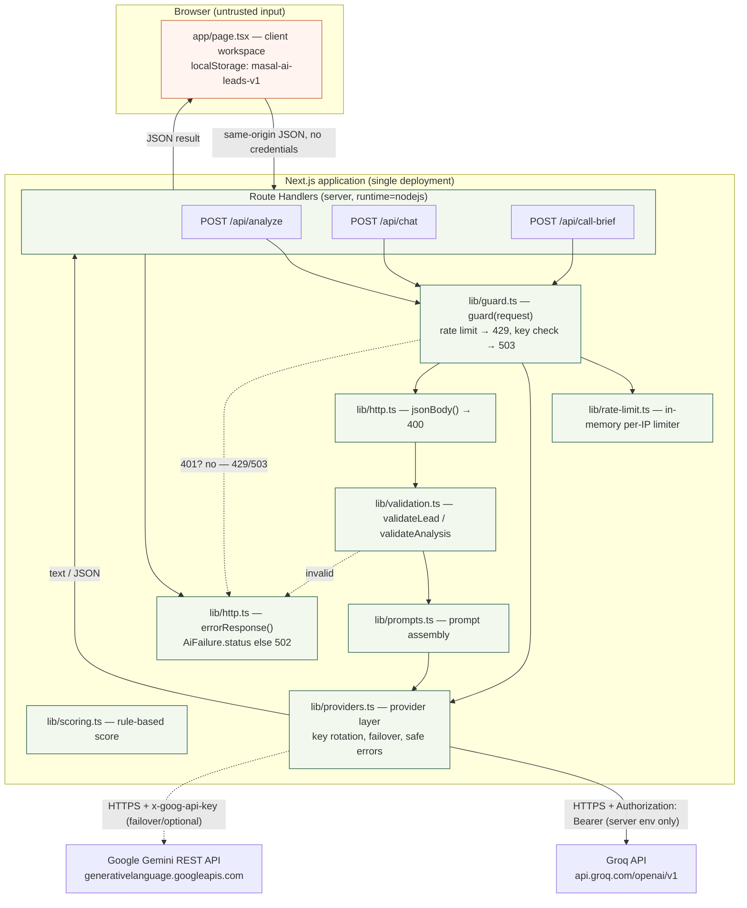
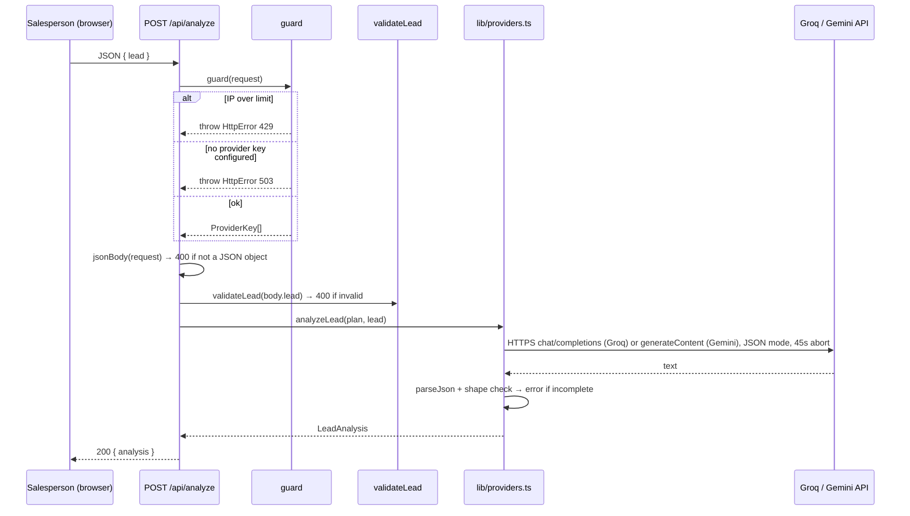
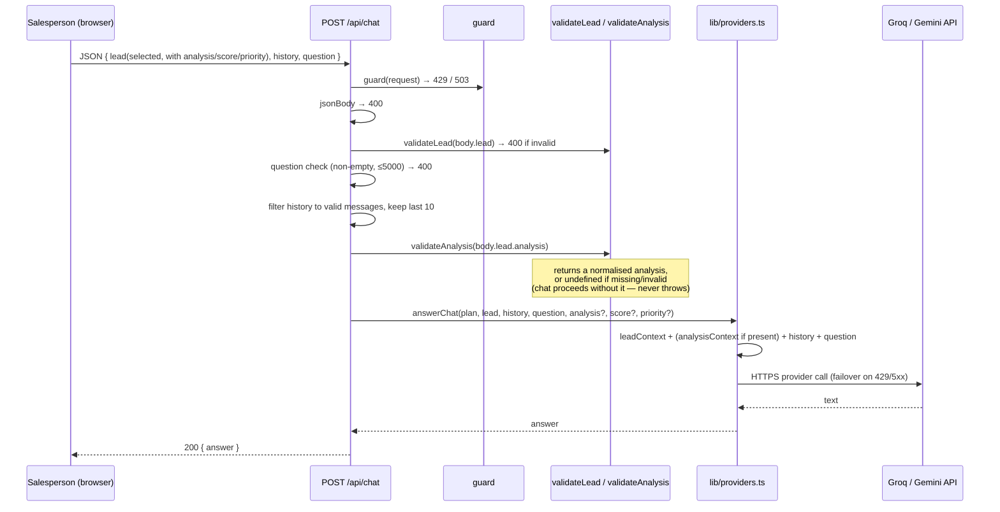
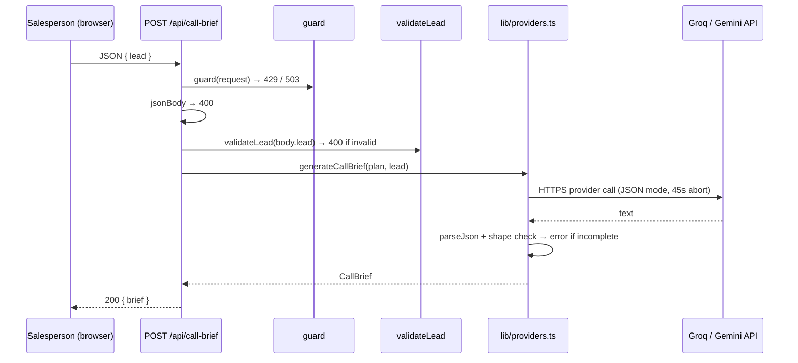

# Masal AI — Architecture

This document describes the system as it is implemented in this repository. It is a technical reference, not a marketing overview; product framing lives in the [README](../README.md). Where a section describes expected platform behaviour (for example, Vercel), that is called out explicitly.

## 1. Purpose and scope

Masal AI is a single Next.js application that helps a real-estate salesperson triage inbound leads. It combines:

- a client-side single-page workspace for capture, ranking, and display;
- server-side Route Handlers that keep the AI provider keys off the client, validate input, apply a coarse rate limit, and call an external provider (Groq by default, with optional multi-key rotation and Gemini failover);
- a small, deterministic scoring module for transparent prioritisation.

In scope: the lead workspace, three AI-backed endpoints, request guards, validation, scoring, and the tests around them.

Out of scope (not implemented): authentication, authorization, multi-user tenancy, durable storage, background jobs, and any database.

## 2. System context

| Actor / system | Role |
| --- | --- |
| Salesperson (browser) | Uses the single-page workspace: capture leads, read AI analysis, chat, generate call briefs, rank the pipeline. Holds all lead state in `localStorage`. |
| Next.js application | Hosts both the client UI and the server Route Handlers in one deployable unit. |
| Server-side API routes | `/api/analyze`, `/api/chat`, `/api/call-brief` — the only trusted boundary for input and credentials. |
| External LLM provider(s) | Groq (OpenAI-compatible `api.groq.com`) primary by default; Google Gemini (`generativelanguage.googleapis.com`) as an optional failover or alternate primary. Called over HTTPS by the server routes. |
| Deployment environment | Any Node.js-capable host; Vercel is the documented target (see §10). The repository contains no `vercel.json`. |

No other external service is used. There is no database, cache, queue, or auth provider.

## 3. Architecture diagram

Trust boundaries and the server-side credential handling are shown explicitly. Nothing below the browser line is reachable or visible to the client except the JSON response bodies.

Reading the diagram: the browser is the untrusted input source and never holds credentials. Every request passes through `guard` (rate limit, then key check) and `jsonBody`/validation before any prompt is built. Provider keys are supplied to the outbound request only inside `lib/providers.ts`, from the server environment.

## 4. Component and responsibility map

| Path | Responsibility |
| --- | --- |
| `app/page.tsx` | Client workspace (`"use client"`): lead list, intake form, per-lead analysis panel, copilot chat, call brief, status, search/filter, stats, and the light/dark theme toggle. Owns all lead state and `localStorage` persistence. |
| `app/layout.tsx` | Root layout, page metadata, and a small inline script that applies the saved theme class before paint (no flash). |
| `app/globals.css` | Tailwind layers plus the light/dark design tokens (`:root` / `.dark` CSS variables) that `app/page.tsx` consumes. |
| `app/api/analyze/route.ts` | POST handler: guard → parse → validate lead → `analyzeLead` → `{ analysis }`. |
| `app/api/chat/route.ts` | POST handler: guard → parse → validate lead/question/history/analysis → `answerChat` → `{ answer }`. |
| `app/api/call-brief/route.ts` | POST handler: guard → parse → validate lead → `generateCallBrief` → `{ brief }`. |
| `lib/guard.ts` | `HttpError` and `guard(request)`: applies the rate limit and resolves the ordered provider plan (`ProviderKey[]`). Pure of `next/server`. |
| `lib/http.ts` | `errorResponse()` (status mapping + safe message) and `jsonBody()` (JSON-object parsing). Re-exports `guard`/`HttpError`. |
| `lib/rate-limit.ts` | In-memory per-IP sliding-window limiter, `clientIp()` extraction, coarse quota warning. |
| `lib/validation.ts` | `validateLead` (field shape, lengths, timeline allow-list), `validateAnalysis` (analysis shape + limits, returns `undefined` when invalid), `readJsonObject` (used by tests). |
| `lib/scoring.ts` | `scoreLead` (deterministic 100-point engine with per-dimension breakdown) and `priorityForScore`: sales-priority labels (`Act Now`/`Follow Up`/`Nurture`), thresholds, and display styles. |
| `lib/prompts.ts` | `leadContext`, `analysisContext`, and the three system prompts. |
| `lib/providers.ts` | The provider layer: env key/model resolution with numbered-key rotation, an ordered provider plan, cooldown/failover (`attemptWithFailover`), the Groq and Gemini `fetch` transports (45s abort), `analyzeLead`/`answerChat`/`generateCallBrief`, `AiFailure`, and `safeAiError`. |
| `types/lead.ts` | Shared contracts: `LeadInput`, `LeadAnalysis`, `Lead`, `ChatMessage`, `CallBrief`, `Priority`, `LeadStatus`, `BUYING_TIMELINES`, `ScoreDimension`, `LeadScoreDetail`. |

Separation of concerns: UI and state live in `app/page.tsx`; domain types in `types/`; prompt text in `lib/prompts.ts`; provider transport, key resolution, and failover in `lib/providers.ts`; request handling in `lib/http.ts` and `lib/guard.ts`; input policy in `lib/validation.ts`. This keeps the "what to ask" (prompts), "how to call and who to blame on failure" (providers), "who may call" (guard/rate-limit), and "is it valid" (validation) independent.

## 5. Core data model

Defined in `types/lead.ts`.

**Intake (`LeadInput`)**

| Field | Type | Notes |
| --- | --- | --- |
| `name` | string | 2–120 chars (validated). |
| `location` | string | Non-empty, ≤160 chars. |
| `propertyRequirement` | string | Non-empty, ≤300 chars. |
| `budget` | string | Non-empty, ≤120 chars (free text; not parsed numerically). |
| `timeline` | `BuyingTimeline` | One of `BUYING_TIMELINES` (allow-listed); legacy labels (`Immediately`, `1–3 months`, `3–6 months`) are normalized to the current buckets by `normalizeTimeline`. |
| `message` | string | 5–10,000 chars. |

**Analysis (`LeadAnalysis`)** — produced by `/api/analyze`: `summary`, `intent`, `requirements[]`, `concerns[]`, `nextAction`, `suggestedReply`, `intentStrength` (`Strong`/`Moderate`/`Weak`), `confidenceNote`, and the separation fields `knownFacts[]`, `inferences[]`, `unknowns[]`, `dealRisks[]`. The model separates confirmed facts from inferences and unknowns and does not produce a numeric score.

**Lead (`Lead`)** — a `LeadInput` plus `id`, `createdAt`, `updatedAt`, `score` (0–100, computed by `lib/scoring.ts`, never by the LLM), `priority` (`Act Now`/`Follow Up`/`Nurture`), `scoreReasons[]` (positive signals), optional `scoreDetail` (`{ dimensions[], missing[], summary }` — the deterministic breakdown), `status` (`New`/`Contacted`/`Visit scheduled`/`Qualified`/`Closed`), `analysis` (a `LeadAnalysis`), `chat` (`ChatMessage[]`), and optional `callBrief` (`CallBrief`).

**Deterministic score (`lib/scoring.ts`).** `scoreLead(input, { status })` returns a 0–100 score, a priority label, and five `ScoreDimension`s whose maxima sum to 100: buying timeline (25), purchase intent (25), requirement clarity (20), budget readiness (20), engagement & commitment (10). Each dimension reports `earned`/`max`, evidence (positive signals), and missing information, so an unknown is distinguishable from a zero. Priority: `Act Now` ≥80, `Follow Up` 50–79, `Nurture` <50. The score is recomputed on create, on load (migrating legacy labels), and when the lead status changes (which affects the engagement dimension). The LLM may interpret intent but never calculates or overrides the score.

**Chat (`ChatMessage`)** — `id`, `role` (`user`/`assistant`), `content`, `createdAt`.

**Call brief (`CallBrief`)** — `objective`, `talkingPoints[]`, `questions[]`, `watchOutFor[]`, `openingLine`.

### Persistence — where state actually lives

| Layer | What is held | Durability |
| --- | --- | --- |
| Browser React state | The working `leads` array, selection, filters, form fields. | Lost on page reload. |
| Browser `localStorage` (`masal-ai-leads-v1`) | The full `leads` array (leads, analyses, chat, call briefs), plus a schema version at `masal-ai-leads-version`. | Per-browser, per-device. Survives reloads; cleared with site data; never synced. The workspace starts empty — no sample leads are ever seeded — and only leads the salesperson creates are persisted (`lib/leads.ts`). Legacy seeded records are dropped on load by a targeted, idempotent migration (`migrateSeededLeads`) that matches the deterministic seed ids (`demo-1`/`demo-2`/`demo-3`) as well as the later `demo: true` flag, so records written before the flag existed are still removed; anything not positively identified — including a real customer who happens to share a seed's name — is kept. `loadStoredLeads` reports whether a legacy version was migrated so the app stamps the current version and the scan does not repeat. |
| Server memory | The rate limiter's `hits` map and a `served` counter; the provider layer's key-rotation counter and per-key cooldown map. | Per serverless instance; reset on cold start; not shared across instances. |
| Durable database | **None.** | Not implemented. |

No lead data is sent to or stored on the server beyond the lifetime of a request; the server only receives the lead fields needed to build a prompt.

## 6. Main sequence diagrams

### 6.1 Lead analysis

### 6.2 Contextual chat (analysis context + selected-lead scoping)

The client sends the *selected* lead object (including its current `analysis`, `score`, and `priority`) plus that lead's `history` and the new `question`. The server re-validates everything and only then builds the prompt.

Scoping: context is derived from the single `lead` object the client sends for the currently selected lead, and chat is stored per lead in `lead.chat` (`app/page.tsx`). Switching leads changes which `lead`/`history` is sent, so one lead's analysis or conversation does not enter another lead's prompt. The server does not hold per-conversation state.

### 6.3 Call brief

## 7. API contract reference

All three endpoints are `POST`, run with `runtime = "nodejs"`, accept and return JSON, and set `Cache-Control: no-store` on success. There are no credential headers — credentials are server-side only.

| Method | Path | Request body | Success response |
| --- | --- | --- | --- |
| POST | `/api/analyze` | `{ lead: LeadInput }` | `200 { analysis: LeadAnalysis }` |
| POST | `/api/chat` | `{ lead: LeadInput & { analysis?: LeadAnalysis, score?: number, priority?: Priority }, history?: ChatMessage[], question: string }` | `200 { answer: string }` |
| POST | `/api/call-brief` | `{ lead: LeadInput }` | `200 { brief: CallBrief }` |

`LeadInput` is exactly the six intake fields (`name`, `location`, `propertyRequirement`, `budget`, `timeline`, `message`); any other fields on `lead` are ignored by `validateLead`. On `/api/chat`, `analysis`/`score`/`priority` are optional context and are validated/normalised before use.

Error responses use `{ error: string }` with a status derived from `errorResponse`:

| Status | When (from code) |
| --- | --- |
| `400` | Body is not a JSON object (`jsonBody`); lead fields invalid (`validateLead`); chat question missing or >5000 chars. |
| `429` | Client IP exceeded the rate limit (`guard`). |
| `503` | No AI provider key is configured (`guard` → provider plan is empty). |
| `502` | Any other error, including upstream provider failures or an incomplete/unreadable model response (`errorResponse` default). |

No status codes beyond these are produced by the routes.

## 8. AI integration

**Provider layer (`lib/providers.ts`).** The former `lib/ai.ts` + `lib/gemini.ts` pair is replaced by one module that owns key resolution, provider selection, failover, transport, and safe error mapping.

*Credentials, model selection, and rotation.* Keys are read from `process.env` and never taken from the client. Each provider accepts a base key plus numbered keys (`GROQ_API_KEY`, `GROQ_API_KEY_2` … up to a bounded maximum of 5). A key is ignored when it is empty, longer than 512 chars, or contains CR/LF. `AI_PROVIDER` selects the primary (`groq` by default, or `gemini`); the other configured provider is kept as a failover. Models are allow-listed per provider — Groq `openai/gpt-oss-120b` (default) or `openai/gpt-oss-20b`; Gemini `gemini-flash-lite-latest` (default), `gemini-3.5-flash-lite`, or `gemini-3.1-flash-lite` — with anything unsupported falling back to the default. (The Gemini `2.5` ids were retired and now return `404`; full-size flash models can return `503` on free-tier keys, so the default is a rolling lite alias.) When more than one key is configured for a provider, a module counter rotates the starting key across requests.

*Failover and cooldowns.* `attemptWithFailover` walks the ordered `ProviderKey[]` and, on a retryable failure, tries the next key/provider, bounded to two passes. Classification drives behaviour: `429`/rate-limit honours `Retry-After` (capped) and cools the key down then fails over; `401`/`403` (auth) puts the key in a long cooldown and does not retry endlessly; `5xx`/network/timeout retries transiently with a short cooldown; invalid/malformed responses are terminal. Cooldown state is keyed per provider key. If every option fails, the result is a safe `AiFailure` — content is never fabricated. This rotation/failover state is **in-memory and per serverless instance** (reset on cold start, not shared across instances, and it does not bypass an account-level provider quota).

**Prompt assembly (`lib/prompts.ts`).** `leadContext(lead)` renders the six intake fields. `analysisContext(analysis, score?, priority?)` renders the existing analysis and, when present, the rule-based score/priority. `answerChat` composes `leadContext` + `analysisContext` (only if a valid analysis survived validation) + the recent conversation + the question. `analyzeLead` and `generateCallBrief` use `leadContext` only (their output *is* the analysis/brief). Three system prompts (`ANALYSIS_PROMPT`, `CHAT_PROMPT`, `CALL_BRIEF_PROMPT`) instruct the model to use only supplied context and not to invent facts.

**Transport.** Structured calls issue one `fetch` per attempt with an `AbortController` timeout of 45 seconds, `temperature: 0.3`, JSON output for structured calls, and the provider's auth header (`Authorization: Bearer …` for Groq's OpenAI-compatible endpoint, `x-goog-api-key` for Gemini) taken from the request-scoped key. Calls are `cache: "no-store"` and built per request — no shared provider client.

**Output handling.** Structured responses are parsed with `parseJson`; `analyzeLead` and `generateCallBrief` then check the expected fields/types and throw on an incomplete result. Chat returns raw text. History entries are truncated (`content.slice(0, 3000)`, last 10) and the question is capped at 5000 chars before being placed in the prompt.

**Failure handling.** A 45-second timeout aborts the request and raises "Request timed out". Failures are reduced to safe messages by `safeAiError` (invalid key, quota/rate limit, transient/network, timeout, malformed). None of these expose keys or raw provider payloads.

## 9. Security and trust boundaries

- **API keys never reach the client.** Keys are read only inside Route Handlers (`lib/providers.ts` via `guard`) and attached only to the outbound provider request. No `NEXT_PUBLIC_*` variables are used, and no key is written to responses, `localStorage`, or logs.
- **Input validation at the boundary.** Every route parses the body as a JSON object, validates the lead fields (lengths, timeline allow-list), validates the chat question and history shape, and validates any client-supplied analysis against a defined shape with length limits. Invalid input returns `400` before any provider call. Client-supplied values are treated as untrusted, including the analysis.
- **Output handling.** Model JSON is parsed and shape-checked before display; provider errors are mapped to generic messages.
- **Rate limiting.** `guard` calls `allowRequest(clientIp(request))` (a sliding window: 20 requests / 10 minutes / IP). The limiter is in-memory and per instance, and resets on cold start; it is a coarse abuse guard, not a global quota. `clientIp` uses the leftmost `x-forwarded-for`, then `x-real-ip`, then `"unknown"`.
- **Trusted-proxy assumption.** Behind Vercel's edge, `x-forwarded-for` is set from the connection, so the leftmost value is trustworthy. Behind another proxy/CDN that does not overwrite the header, it is client-controllable and the per-IP key is spoofable (see the note in `lib/rate-limit.ts`).
- **Absent controls (limitations, not features).** No authentication, no authorization, no tenancy isolation, no CSRF-specific handling (routes are same-origin JSON POSTs), no explicit CORS configuration, no audit logging, and no durable storage. There is nothing stopping a caller from submitting arbitrary lead text to the AI endpoints other than the rate limit.

## 10. Deployment architecture

- **Arrangement.** A standard Next.js app that runs a client bundle and Node.js Route Handlers in one deployment. The README documents Vercel as the target. The repository contains `next.config.ts` (`poweredByHeader: false`) but **no `vercel.json`** and no other deployment configuration, so the Vercel arrangement below is the expected platform behaviour for a Next.js app rather than a repository-verified fact.
- **Required environment variables.** At least one provider API key (`GROQ_API_KEY`, or `GEMINI_API_KEY` if configured as primary). Optional: `AI_PROVIDER`, `GROQ_MODEL`, `GROQ_API_KEY_2`…`GROQ_API_KEY_5`, `GEMINI_MODEL`. Set in the host's environment settings; for Vercel, under **Settings → Environment Variables**, then redeploy.
- **Build and CI.** `.github/workflows/ci.yml` runs on Node 22 for pushes and PRs to `main`: `npm ci` → `npm test` → `npm run typecheck` → `npm run lint` → `npm run build`. The `package-lock.json` is committed and CI installs from it for reproducibility. `next start` serves the production build.
- **Not verified here.** There is no deployed URL in this repository; the README uses a placeholder. Runtime behaviour on the hosting platform (cold starts, per-instance rate-limit scope, Fluid compute limits) is expected platform behaviour and has not been observed from this repository.

## 11. Reliability and failure modes

| Condition | Behaviour (from code) |
| --- | --- |
| No provider key configured | `guard` throws → `503` `{ error }`. The UI loads and shows the message; no provider call is made. |
| Rate limit exceeded | `guard` → `429` `{ error }` ("Too many requests…"). |
| Invalid body / lead / question | `400` `{ error }` before any provider call. |
| Invalid/missing analysis on chat | `validateAnalysis` returns `undefined`; the chat proceeds grounded in the lead fields only. Never throws. |
| Provider rate limit (429) | Key cooled down (honouring `Retry-After`, capped) and the next key/provider is tried; if all fail, `safeAiError` → generic message, status `502`. |
| Provider auth error (401/403) | That key is put in a long cooldown and not retried endlessly; failover proceeds. |
| Upstream provider error / 5xx | Retried transiently within a bounded pass count, then mapped by `safeAiError` to a generic message; status `502`. |
| Timeout (>45s) | `AbortController` aborts; error "Request timed out" → `502`. |
| Empty or unreadable model JSON | Throws; `502` with a generic retry message. |
| Client cancellation | The client uses `fetch` without an explicit abort controller; if a request fails, `app/page.tsx` rolls back the optimistic chat message and shows a notice. There is no server-side cancellation beyond the 45s timeout. |
| State loss | Lead data lives only in `localStorage`; clearing site data, using another browser/device, or private windows loses it. The rate limiter resets across instances/cold starts. |

## 12. Testing strategy

Tests use Node's built-in runner with `--experimental-strip-types` (`npm test`), so they run without a test framework dependency.

| File | Covers |
| --- | --- |
| `tests/validation.test.ts` | `validateLead` (valid lead, invalid timeline), `readJsonObject`, and `validateAnalysis` (normalisation + length limits; safe rejection of missing/malformed input). |
| `tests/scoring.test.ts` | `scoreLead` deterministic scoring: each dimension's rules, missing-data handling, flexible budgets, engagement (none vs confirmed visit), priority boundaries (0/49/50/79/80/100), determinism, breakdown/evidence, 0–100 invariants, and the realistic Rahul lead. |
| `tests/rate-limit.test.ts` | Burst-then-block, per-IP isolation, window reset (with mocked timers), and `clientIp` parsing. |
| `tests/http.test.ts` | `guard`: `429` when the IP is over the limit, `503` when no provider key is configured, and that it returns the provider plan. |
| `tests/providers.test.ts` | Provider routing and failover with a stubbed `fetch`: Groq is primary by default, `AI_PROVIDER=gemini` flips it, model allow-list/fallback, blank keys ignored, multi-key rotation, rate-limited key cooldown and skip, `429` → secondary provider, `401/403` bounded (no endless retry), `5xx` bounded, all-fail yields a safe error (never fabricated content), and transient retry happens once per option. |
| `tests/chat.test.ts` | That a lead's analysis and score reach the chat prompt (captures the outbound payload with a stubbed `fetch`), and that chat works without an analysis. |
| `tests/leads.test.ts` | `lib/leads.ts` workspace lifecycle: fresh/invalid storage yields zero leads, seeded demo records are dropped by the `demo: true` flag *and* by seed id (the flagless legacy records that caused the bug) while ambiguous or same-named records are kept, the cleanup is idempotent, `loadStoredLeads` flags a legacy store for migration exactly once, newly created leads round-trip through storage, `pipelineStats` reports zeros for an empty workspace, and `resolveSelectedLead` returns `undefined` when there is no lead. |

Unit tests never call a real provider API. `npm run typecheck` (`tsc --noEmit`), `npm run lint` (ESLint), and `npm run build` (Next.js) are run alongside tests in CI. There are no route-level integration tests or end-to-end tests; endpoint behaviour is exercised indirectly through the shared modules.

## 13. Architectural trade-offs and known limitations

- **Server-side key for a frictionless demo.** Reviewers can use the deployment with no setup, at the cost of a shared key and shared free-tier quota. A per-user BYO-key model would avoid that but adds friction.
- **Multi-key rotation and failover in one process.** Rotating numbered keys and failing over between providers improves resilience against a single-key `429`, but the cooldown/rotation state is per-instance and in-memory, and rotation cannot exceed an account- or org-level provider quota. A shared store would be needed for a true global view.
- **`localStorage` instead of a database.** No provisioning, but single-browser, non-synced, non-durable persistence.
- **In-memory rate limiting.** No dependency, but per-instance and non-durable — not a global cap.
- **`fetch` instead of provider SDKs.** A small, explicit integration with per-request keys shared across both providers, but no SDK-level retries/streaming.
- **Deterministic score alongside the LLM.** Stable, testable ranking from explicit rules (keyword/timeline/field heuristics) applied to recorded data, with a visible per-dimension breakdown — not a learned model, and not the LLM's judgement. A high score is a prioritisation hint, not proof the lead is sales-qualified or likely to close.
- **Client-supplied analysis context.** The chat accepts the lead's analysis from the client for grounding; the server validates its shape but cannot prove it originated from a prior server call. It is a grounding aid, not a trust source.
- **CSS-variable theming.** Light/dark is driven by a `:root`/`.dark` token set and a `class` strategy on `<html>`, toggled client-side with `localStorage`; there is no server-known theme, so the initial class is applied by a small inline script to avoid a flash.
- **No auth/tenancy/audit.** Suitable for a time-boxed demo; not for real customer data.

## 14. Future improvements (not implemented)

- A durable store (e.g. a hosted database) with per-user accounts and tenancy isolation.
- A distributed rate limiter (e.g. a shared key-value store) for a true global cap.
- Route-level and end-to-end tests, and a mocked provider for deterministic AI-path coverage.
- Streaming responses and an explicit client-side abort/cancel for long calls.
- Storing the server-produced analysis keyed by lead id so chat grounding does not rely on client-supplied context.
- Observability (structured request/error logging) without logging secrets.

These are proposals only; none are present in the current code.

## 15. End-to-end request lifecycle

1. The salesperson acts in `app/page.tsx`; the component issues a same-origin `POST` with a JSON body (no credentials).
2. Next.js invokes the matching Route Handler (`runtime = "nodejs"`).
3. `guard(request)` applies the per-IP rate limit (`429`) and resolves the ordered provider plan (`503` if no key is configured).
4. `jsonBody` parses the body (`400` if not a JSON object); `validateLead` (and, for chat, the question/history/analysis checks) validate fields (`400`).
5. The route calls `lib/providers.ts`, which assembles the prompt (`lib/prompts.ts`) and issues one HTTPS request to the selected provider with a 45-second timeout, rotating keys and failing over on retryable errors.
6. The response is parsed and shape-checked (`analyze`/`call-brief`) or returned as text (`chat`); failures are mapped to safe messages by `safeAiError`.
7. The route returns `{ analysis }`, `{ answer }`, or `{ brief }` with `Cache-Control: no-store`; any thrown `HttpError`/unexpected error goes through `errorResponse` (`HttpError.status`, else `502`).
8. The client stores the result on the selected lead and re-renders; the update is persisted to `localStorage`. The server keeps no lead state between requests — only the in-memory rate limiter survives, per instance.
