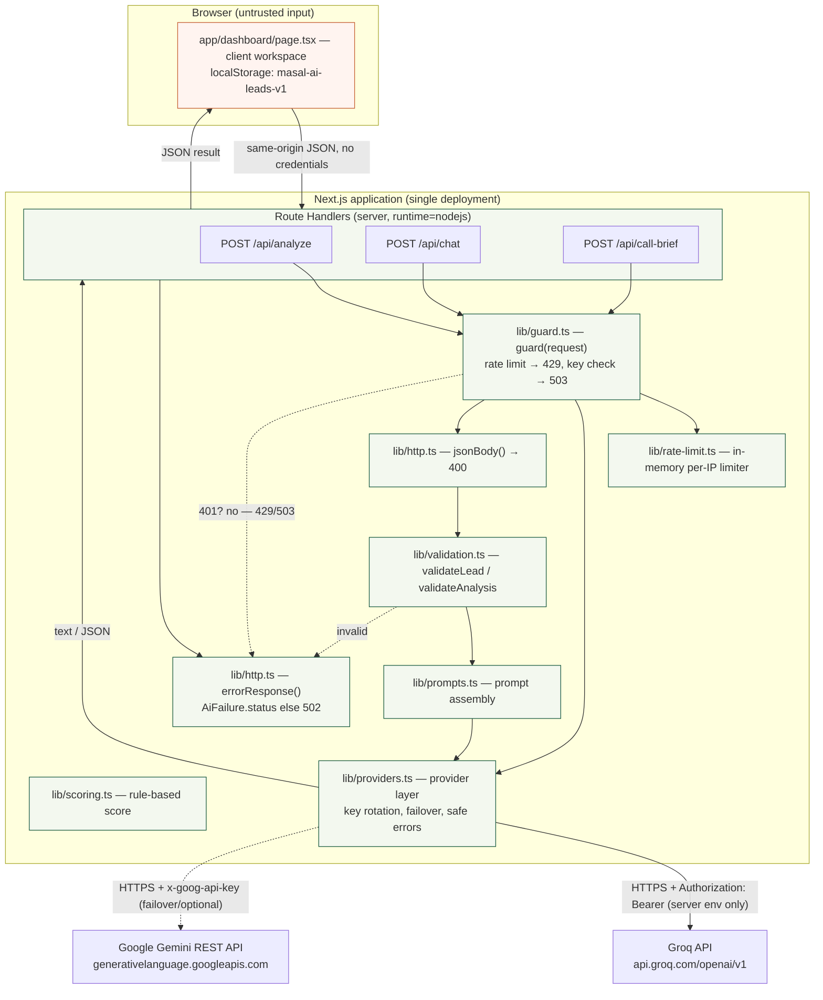
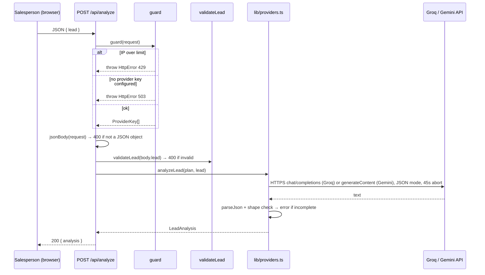
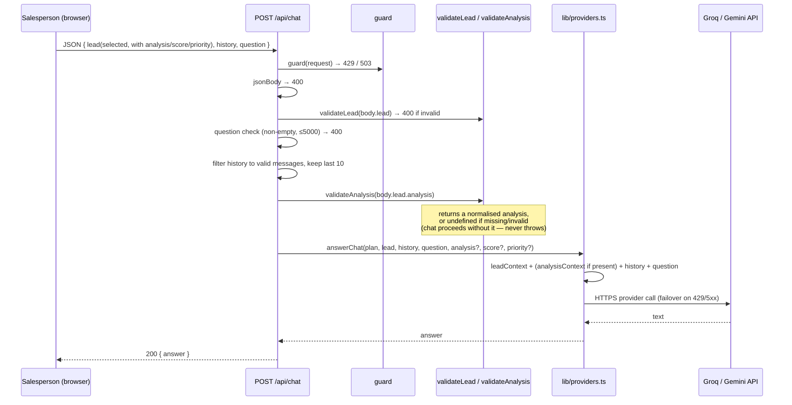
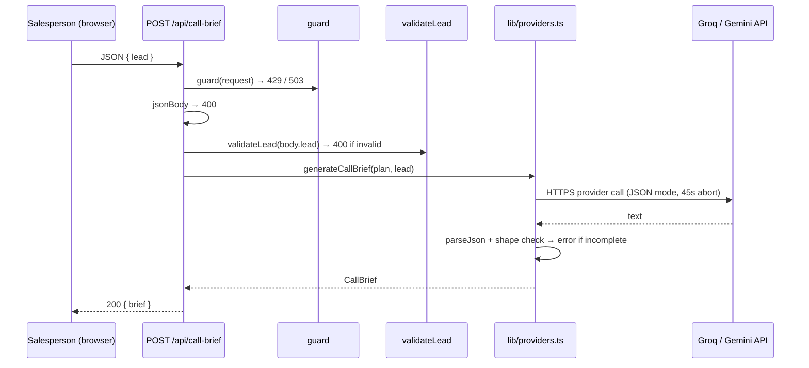

# Masal AI — Architecture

This document describes the system as it is implemented in this repository. It is a technical reference, not a marketing overview; product framing lives in the [README](../README.md). Where a section describes expected platform behaviour (for example, Vercel), that is called out explicitly.

## 1. Purpose and scope

Masal AI is a single Next.js application that helps a real-estate salesperson triage inbound leads. It combines:

- a static landing page at `/` and a client-side workspace at `/dashboard` for capture, ranking, and display;
- server-side Route Handlers that keep the AI provider keys off the client, validate input, apply a coarse rate limit, and call an external provider (Groq by default, with optional multi-key rotation and Gemini failover);
- a small, deterministic scoring module for transparent prioritisation.

In scope: the lead workspace, three AI-backed endpoints, request guards, validation, scoring, and the tests around them.

Out of scope (not implemented): authentication, authorization, multi-user tenancy, durable storage, background jobs, and any database.

## 2. System context

| Actor / system | Role |
| --- | --- |
| Salesperson (browser) | Uses the workspace at `/dashboard`: capture leads, read AI analysis, chat, generate call briefs, rank the pipeline. Holds all lead state in `localStorage`. |
| Next.js application | Hosts both the client UI and the server Route Handlers in one deployable unit. |
| Server-side API routes | `/api/analyze`, `/api/chat`, `/api/call-brief` — the only trusted boundary for input and credentials. |
| External LLM provider(s) | Groq (OpenAI-compatible `api.groq.com`) primary by default; Google Gemini (`generativelanguage.googleapis.com`) as an optional failover or alternate primary. Called over HTTPS by the server routes. |
| Deployment environment | Any Node.js-capable host; Vercel is the documented target (see §10). The repository contains no `vercel.json`. |

No other external service is used. There is no database, cache, queue, or auth provider.

## 3. Architecture diagram

Trust boundaries and the server-side credential handling are shown explicitly. Nothing below the browser line is reachable or visible to the client except the JSON response bodies.

Reading the diagram: the browser is the untrusted input source and never holds credentials. Every request passes through `guard` (rate limit, then key check) and `jsonBody`/validation before any prompt is built. Provider keys are supplied to the outbound request only inside `lib/providers.ts`, from the server environment.

## 4. Component and responsibility map

| Path | Responsibility |
| --- | --- |
| `app/page.tsx` | Static landing page (server component) for `/`: header (home icon, the `masal.ai` wordmark, compact theme toggle, one `Open Dashboard` CTA), an editorial hero that leads with the `masal.ai` wordmark plus a customer-neutral workflow diagram (buyer requirements → evidence-based sales priority → next best action), the "how it works" steps (three cards revealed on scroll by `components/scroll-reveal.tsx`), then a lead-scoring section — a two-column layout pairing the "How leads are ranked" card (sales-priority legend with glowing indicators, the 100-point breakdown with green bars, and a recommended next action) with the factor-by-factor explanation and the priority guidance. A minimal footer repeats the small brand mark and holds the legal links; the brand is one `Wordmark` component reused at three sizes. No screenshots, mock data, or invented proof. Copy and the dashboard route live in `lib/landing.ts`. |
| `app/dashboard/page.tsx` | Client workspace (`"use client"`) at `/dashboard`: a sidebar nav rail (brand, `+ Add Lead`, search, priority filters, the three labelled demo scenarios grouped under "Sample scenarios" and genuine leads under "Your leads", and a remove/restore-demos control), the main welcome state, and a selected-lead view (score ring, summary facts, a decision section — recommended next action / open questions / known facts / deal risks — and compact Overview / AI Analysis / Call Brief / Sales Copilot tabs). Owns all lead state and genuine-only `localStorage` persistence. |
| `app/layout.tsx` | Root layout, page metadata, and the font variables. The pre-paint inline script applies the stored theme (falling back to the light default when none is stored) and marks the document `js`, so the landing scroll reveal only starts cards hidden when JavaScript is enabled (no content is hidden without JS). |
| `app/globals.css` | Tailwind layers plus the centralized design tokens for both themes (light on `:root` — the default — dark on `:root[data-theme="dark"]`) — surfaces, text, brand accent, and the shared `--priority-*` sales-priority colours with their restrained glow — consumed by the landing page, dashboard, and legal pages. Also defines the `.priority-*` label classes and the scroll-reveal states. |
| `app/dashboard/layout.tsx` | Server layout for `/dashboard`: sets the route metadata (`title: "Dashboard"`) and `noindex` (the workspace is an app screen), then renders the client workspace. |
| `app/legal-shell.tsx` | Shared shell for the static legal pages (header, footer, section styling). |
| `app/privacy/page.tsx`, `app/terms/page.tsx` | Static legal copy, reached from the landing-page footer. |
| `app/not-found.tsx` | 404 page that links back to `/dashboard`. |
| `app/robots.ts`, `app/sitemap.ts`, `app/opengraph-image.tsx`, `app/icon.svg` | Crawler and social-preview assets. The sitemap lists `/`, `/privacy`, `/terms` (the noindexed dashboard and API routes are excluded). |
| `lib/site.ts` | Canonical site URL, name, and description, shared by metadata, `robots`, and `sitemap`, plus the sales identity (`SALESPERSON_NAME`, `COMPANY_NAME`) used to personalise the Call Brief. |
| `lib/landing.ts` | Landing-page copy (hero, the three workflow steps), the dashboard route constants, and the scoring copy: `scoringFactors()` (the five weighted factors with their explanations, read from the engine), `priorityBand()` (each priority's score range, derived from the engine's thresholds — never restated), and `PRIORITY_GUIDANCE` (the action each priority implies). Kept JSX-free so the Node test runner can assert the copy, route wiring, and factor/threshold agreement with the engine. |
| `lib/demos.ts` | The three labelled demo scenarios (`buildDemoLeads`): reserved `demo-` ids, `demo: true`, one per priority band, plus `isDemoLead` (flag, reserved id, legacy `sample-` family), `leadDisplayName` (adds the `(Dummy)` suffix), and `removeDemoLeads`. |
| `app/api/analyze/route.ts` | POST handler: guard → parse → validate lead → `analyzeLead` → `{ analysis }`. |
| `app/api/chat/route.ts` | POST handler: guard → parse → validate lead/question/history/analysis → `answerChat` → `{ answer }`. |
| `app/api/call-brief/route.ts` | POST handler: guard → parse → validate lead → `generateCallBrief` → `{ brief }`. |
| `lib/guard.ts` | `HttpError` and `guard(request)`: applies the rate limit and resolves the ordered provider plan (`ProviderKey[]`). Pure of `next/server`. |
| `lib/http.ts` | `errorResponse()` (status mapping + safe message) and `jsonBody()` (JSON-object parsing). Re-exports `guard`/`HttpError`. |
| `lib/rate-limit.ts` | In-memory per-IP sliding-window limiter, `clientIp()` extraction, coarse quota warning. |
| `lib/validation.ts` | `validateLead` (field shape, lengths, timeline allow-list), `validateLeadFields` (the same rules as per-field messages, shared with the dashboard intake form), `validateAnalysis` (analysis shape + limits, returns `undefined` when invalid), `readJsonObject` (used by tests). |
| `lib/scoring.ts` | `scoreLead` (deterministic 100-point engine with per-dimension breakdown) and `priorityForScore`: sales-priority labels (`Act Now`/`Follow Up`/`Nurture`), thresholds, and the shared display mapping (`PRIORITY_STYLES` class names, `PRIORITY_BAR` colour tokens) defined once against the theme so a priority reads the same everywhere. |
| `lib/prompts.ts` | `leadContext`, `analysisContext`, and the three system prompts, plus the sales identity constants and the `resolveIdentityPlaceholders`/`resolveCallBriefIdentity` helpers that replace any `[Your Name]`/`[Company Name]`-style token a model might echo with the real salesperson and company. |
| `lib/providers.ts` | The provider layer: env key/model resolution with numbered-key rotation, an ordered provider plan, cooldown/failover (`attemptWithFailover`), the Groq and Gemini `fetch` transports (45s abort), `analyzeLead`/`answerChat`/`generateCallBrief` (the brief resolves any identity placeholder before returning), `AiFailure`, and `safeAiError`. |
| `types/lead.ts` | Shared contracts: `LeadInput`, `LeadAnalysis`, `Lead`, `ChatMessage`, `CallBrief`, `Priority`, `LeadStatus`, `BUYING_TIMELINES`, `ScoreDimension`, `LeadScoreDetail`; `Lead` carries an optional `demo` flag set only on the app's own labelled demo scenarios. |

Separation of concerns: UI and state live in `app/dashboard/page.tsx`; domain types in `types/`; prompt text in `lib/prompts.ts`; provider transport, key resolution, and failover in `lib/providers.ts`; request handling in `lib/http.ts` and `lib/guard.ts`; input policy in `lib/validation.ts`. This keeps the "what to ask" (prompts), "how to call and who to blame on failure" (providers), "who may call" (guard/rate-limit), and "is it valid" (validation) independent.

## 5. Core data model

Defined in `types/lead.ts`.

**Intake (`LeadInput`)**

| Field | Type | Notes |
| --- | --- | --- |
| `name` | string | 2–120 chars (validated). |
| `location` | string | Non-empty, ≤160 chars. |
| `propertyRequirement` | string | Non-empty, ≤300 chars. |
| `budget` | string | Non-empty, ≤120 chars (free text; not parsed numerically). |
| `timeline` | `BuyingTimeline` | One of `BUYING_TIMELINES` (allow-listed); legacy labels (`Immediately`, `1–3 months`, `3–6 months`) are normalized to the current buckets by `normalizeTimeline`. |
| `message` | string | 5–10,000 chars. |

**Analysis (`LeadAnalysis`)** — produced by `/api/analyze`: `summary`, `intent`, `requirements[]`, `concerns[]`, `nextAction`, `suggestedReply`, `intentStrength` (`Strong`/`Moderate`/`Weak`), `confidenceNote`, and the separation fields `knownFacts[]`, `inferences[]`, `unknowns[]`, `dealRisks[]`. The model separates confirmed facts from inferences and unknowns and does not produce a numeric score.

**Lead (`Lead`)** — a `LeadInput` plus `id`, `createdAt`, `updatedAt`, `score` (0–100, computed by `lib/scoring.ts`, never by the LLM), `priority` (`Act Now`/`Follow Up`/`Nurture`), `scoreReasons[]` (positive signals), optional `scoreDetail` (`{ dimensions[], missing[], summary }` — the deterministic breakdown), `status` (`New`/`Contacted`/`Visit scheduled`/`Qualified`/`Closed`), `analysis` (a `LeadAnalysis`), `chat` (`ChatMessage[]`), and optional `callBrief` (`CallBrief`).

**Deterministic score (`lib/scoring.ts`).** `scoreLead(input, { status })` returns a 0–100 score, a priority label, and five `ScoreDimension`s whose maxima sum to 100: buying timeline (25), purchase intent (25), requirement clarity (20), budget readiness (20), engagement & commitment (10). Each dimension reports `earned`/`max`, evidence (positive signals), and missing information, so an unknown is distinguishable from a zero. Priority: `Act Now` ≥80, `Follow Up` 50–79, `Nurture` <50. The score is recomputed on create, on load (migrating legacy labels), and when the lead status changes (which affects the engagement dimension). The LLM may interpret intent but never calculates or overrides the score.

**Chat (`ChatMessage`)** — `id`, `role` (`user`/`assistant`), `content`, `createdAt`.

**Call brief (`CallBrief`)** — `objective`, `talkingPoints[]`, `questions[]`, `watchOutFor[]`, `openingLine`.

### Persistence — where state actually lives

| Layer | What is held | Durability |
| --- | --- | --- |
| Browser React state | The working `leads` array, selection, filters, form fields. | Lost on page reload. |
| Browser `localStorage` (`masal-ai-leads-v1`) | Genuine leads only (leads, analyses, chat, call briefs), plus a schema version at `masal-ai-leads-version`. | Per-browser, per-device. Survives reloads; cleared with site data; never synced. Example demo scenarios are **never written here**. On load, `loadStoredLeads` (`lib/leads.ts`) returns the genuine store plus the three labelled demo scenarios rebuilt from code (`lib/demos.ts`: reserved `demo-` ids, `demo: true`), one per priority band, unless the user removed them — the `masal-ai-demos-dismissed` marker makes a removal stick across reloads. Because the demos are re-derived and never persisted, repeated loads cannot duplicate them, and none is auto-selected (the workspace opens on its welcome state). `parseStoredLeads` drops any demo-identified record an older build may have written (the `demo: true` flag, or the reserved `demo-`/legacy `sample-` id prefix), so it never resurfaces as a genuine lead, while a real customer with a normal generated id is always kept — even one who shares a demo's name. Only leads the salesperson creates are persisted. |
| Server memory | The rate limiter's `hits` map and a `served` counter; the provider layer's key-rotation counter and per-key cooldown map. | Per serverless instance; reset on cold start; not shared across instances. |
| Durable database | **None.** | Not implemented. |

No lead data is sent to or stored on the server beyond the lifetime of a request; the server only receives the lead fields needed to build a prompt.

## 6. Main sequence diagrams

### 6.1 Lead analysis

### 6.2 Contextual chat (analysis context + selected-lead scoping)

The client sends the *selected* lead object (including its current `analysis`, `score`, and `priority`) plus that lead's `history` and the new `question`. The server re-validates everything and only then builds the prompt.

Scoping: context is derived from the single `lead` object the client sends for the currently selected lead, and chat is stored per lead in `lead.chat` (`app/dashboard/page.tsx`). Switching leads changes which `lead`/`history` is sent, so one lead's analysis or conversation does not enter another lead's prompt. The server does not hold per-conversation state.

### 6.3 Call brief

## 7. API contract reference

All three endpoints are `POST`, run with `runtime = "nodejs"`, accept and return JSON, and set `Cache-Control: no-store` on success. There are no credential headers — credentials are server-side only.

| Method | Path | Request body | Success response |
| --- | --- | --- | --- |
| POST | `/api/analyze` | `{ lead: LeadInput }` | `200 { analysis: LeadAnalysis }` |
| POST | `/api/chat` | `{ lead: LeadInput & { analysis?: LeadAnalysis, score?: number, priority?: Priority }, history?: ChatMessage[], question: string }` | `200 { answer: string }` |
| POST | `/api/call-brief` | `{ lead: LeadInput }` | `200 { brief: CallBrief }` |

`LeadInput` is exactly the six intake fields (`name`, `location`, `propertyRequirement`, `budget`, `timeline`, `message`); any other fields on `lead` are ignored by `validateLead`. On `/api/chat`, `analysis`/`score`/`priority` are optional context and are validated/normalised before use.

Error responses use `{ error: string }` with a status derived from `errorResponse`:

| Status | When (from code) |
| --- | --- |
| `400` | Body is not a JSON object (`jsonBody`); lead fields invalid (`validateLead`); chat question missing or >5000 chars. |
| `429` | Client IP exceeded the rate limit (`guard`). |
| `503` | No AI provider key is configured (`guard` → provider plan is empty). |
| `502` | Any other error, including upstream provider failures or an incomplete/unreadable model response (`errorResponse` default). |

No status codes beyond these are produced by the routes.

## 8. AI integration

**Provider layer (`lib/providers.ts`).** The former `lib/ai.ts` + `lib/gemini.ts` pair is replaced by one module that owns key resolution, provider selection, failover, transport, and safe error mapping.

*Credentials, model selection, and rotation.* Keys are read from `process.env` and never taken from the client. Each provider accepts a base key plus numbered keys (`GROQ_API_KEY`, `GROQ_API_KEY_2` … up to a bounded maximum of 5). A key is ignored when it is empty, longer than 512 chars, or contains CR/LF. `AI_PROVIDER` selects the primary (`groq` by default, or `gemini`); the other configured provider is kept as a failover. Models are allow-listed per provider — Groq `openai/gpt-oss-120b` (default) or `openai/gpt-oss-20b`; Gemini `gemini-flash-lite-latest` (default), `gemini-3.5-flash-lite`, or `gemini-3.1-flash-lite` — with anything unsupported falling back to the default. (The Gemini `2.5` ids were retired and now return `404`; full-size flash models can return `503` on free-tier keys, so the default is a rolling lite alias.) When more than one key is configured for a provider, a module counter rotates the starting key across requests.

*Failover and cooldowns.* `attemptWithFailover` walks the ordered `ProviderKey[]` and, on a retryable failure, tries the next key/provider, bounded to two passes. Classification drives behaviour: `429`/rate-limit honours `Retry-After` (capped) and cools the key down then fails over; `401`/`403` (auth) puts the key in a long cooldown and does not retry endlessly; `5xx`/network/timeout retries transiently with a short cooldown; invalid/malformed responses are terminal. Cooldown state is keyed per provider key. If every option fails, the result is a safe `AiFailure` — content is never fabricated. This rotation/failover state is **in-memory and per serverless instance** (reset on cold start, not shared across instances, and it does not bypass an account-level provider quota).

**Prompt assembly (`lib/prompts.ts`).** `leadContext(lead)` renders the six intake fields. `analysisContext(analysis, score?, priority?)` renders the existing analysis and, when present, the rule-based score/priority. `answerChat` composes `leadContext` + `analysisContext` (only if a valid analysis survived validation) + the recent conversation + the question. `analyzeLead` and `generateCallBrief` use `leadContext` only (their output *is* the analysis/brief). Three system prompts (`ANALYSIS_PROMPT`, `CHAT_PROMPT`, `CALL_BRIEF_PROMPT`) instruct the model to use only supplied context and not to invent facts.

**Transport.** Structured calls issue one `fetch` per attempt with an `AbortController` timeout of 45 seconds, `temperature: 0.3`, JSON output for structured calls, and the provider's auth header (`Authorization: Bearer …` for Groq's OpenAI-compatible endpoint, `x-goog-api-key` for Gemini) taken from the request-scoped key. Calls are `cache: "no-store"` and built per request — no shared provider client.

**Output handling.** Structured responses are parsed with `parseJson`; `analyzeLead` and `generateCallBrief` then check the expected fields/types and throw on an incomplete result. Chat returns raw text. History entries are truncated (`content.slice(0, 3000)`, last 10) and the question is capped at 5000 chars before being placed in the prompt.

**Failure handling.** A 45-second timeout aborts the request and raises "Request timed out". Failures are reduced to safe messages by `safeAiError` (invalid key, quota/rate limit, transient/network, timeout, malformed). None of these expose keys or raw provider payloads.

## 9. Security and trust boundaries

- **API keys never reach the client.** Keys are read only inside Route Handlers (`lib/providers.ts` via `guard`) and attached only to the outbound provider request. No `NEXT_PUBLIC_*` variables are used, and no key is written to responses, `localStorage`, or logs.
- **Input validation at the boundary.** Every route parses the body as a JSON object, validates the lead fields (lengths, timeline allow-list), validates the chat question and history shape, and validates any client-supplied analysis against a defined shape with length limits. Invalid input returns `400` before any provider call. Client-supplied values are treated as untrusted, including the analysis.
- **Output handling.** Model JSON is parsed and shape-checked before display; provider errors are mapped to generic messages.
- **Rate limiting.** `guard` calls `allowRequest(clientIp(request))` (a sliding window: 20 requests / 10 minutes / IP). The limiter is in-memory and per instance, and resets on cold start; it is a coarse abuse guard, not a global quota. `clientIp` uses the leftmost `x-forwarded-for`, then `x-real-ip`, then `"unknown"`.
- **Trusted-proxy assumption.** Behind Vercel's edge, `x-forwarded-for` is set from the connection, so the leftmost value is trustworthy. Behind another proxy/CDN that does not overwrite the header, it is client-controllable and the per-IP key is spoofable (see the note in `lib/rate-limit.ts`).
- **Absent controls (limitations, not features).** No authentication, no authorization, no tenancy isolation, no CSRF-specific handling (routes are same-origin JSON POSTs), no explicit CORS configuration, no audit logging, and no durable storage. There is nothing stopping a caller from submitting arbitrary lead text to the AI endpoints other than the rate limit.

## 10. Deployment architecture

- **Arrangement.** A standard Next.js app that runs a client bundle and Node.js Route Handlers in one deployment. The README documents Vercel as the target. The repository contains `next.config.ts` (`poweredByHeader: false`) but **no `vercel.json`** and no other deployment configuration, so the Vercel arrangement below is the expected platform behaviour for a Next.js app rather than a repository-verified fact.
- **Required environment variables.** At least one provider API key (`GROQ_API_KEY`, or `GEMINI_API_KEY` if configured as primary). Optional: `AI_PROVIDER`, `GROQ_MODEL`, `GROQ_API_KEY_2`…`GROQ_API_KEY_5`, `GEMINI_MODEL`. Set in the host's environment settings; for Vercel, under **Settings → Environment Variables**, then redeploy.
- **Build and CI.** `.github/workflows/ci.yml` runs on Node 22 for pushes and PRs to `main`: `npm ci` → `npm test` → `npm run typecheck` → `npm run lint` → `npm run build`. The `package-lock.json` is committed and CI installs from it for reproducibility. `next start` serves the production build.
- **Not verified here.** The README documents a deployment URL (`https://assignment-masal.vercel.app`), which responds, but this repository cannot confirm that the running revision matches any particular commit. Runtime behaviour on the hosting platform (cold starts, per-instance rate-limit scope, Fluid compute limits) is expected platform behaviour and has not been observed from this repository.

## 11. Reliability and failure modes

| Condition | Behaviour (from code) |
| --- | --- |
| No provider key configured | `guard` throws → `503` `{ error }`. The UI loads and shows the message; no provider call is made. |
| Rate limit exceeded | `guard` → `429` `{ error }` ("Too many requests…"). |
| Invalid body / lead / question | `400` `{ error }` before any provider call. |
| Invalid/missing analysis on chat | `validateAnalysis` returns `undefined`; the chat proceeds grounded in the lead fields only. Never throws. |
| Provider rate limit (429) | Key cooled down (honouring `Retry-After`, capped) and the next key/provider is tried; if all fail, `safeAiError` → generic message, status `502`. |
| Provider auth error (401/403) | That key is put in a long cooldown and not retried endlessly; failover proceeds. |
| Upstream provider error / 5xx | Retried transiently within a bounded pass count, then mapped by `safeAiError` to a generic message; status `502`. |
| Timeout (>45s) | `AbortController` aborts; error "Request timed out" → `502`. |
| Empty or unreadable model JSON | Throws; `502` with a generic retry message. |
| Client cancellation | The client uses `fetch` without an explicit abort controller; if a request fails, `app/dashboard/page.tsx` rolls back the optimistic chat message and shows a notice. There is no server-side cancellation beyond the 45s timeout. |
| State loss | Lead data lives only in `localStorage`; clearing site data, using another browser/device, or private windows loses it. The rate limiter resets across instances/cold starts. |

## 12. Testing strategy

Tests use Node's built-in runner with `--experimental-strip-types` (`npm test`), so they run without a test framework dependency.

| File | Covers |
| --- | --- |
| `tests/validation.test.ts` | `validateLead` (valid lead, invalid timeline), `validateLeadFields` (accepts a genuine lead, flags each missing field), `readJsonObject`, and `validateAnalysis` (normalisation + length limits; safe rejection of missing/malformed input). |
| `tests/dashboard.test.ts` | The Add Lead path, data integrity, and security policy: production CSP omits `'unsafe-eval'` and stays self-only, development allows the React Refresh `eval`, the CSP is applied to every route with the full header set, both Add Lead buttons open the same form (gated on `showForm`, closable), submission runs through `createLead`/`validateLeadFields`, an accepted lead round-trips through the persisted store, the workspace loads demos + genuine leads without auto-selecting, it persists genuine leads only, groups Sample scenarios / Your leads with a score ring and compact tabs, removing demos uses the dismissed marker, priority colours come from the shared mapping, and the `(Dummy)` marker is a separate lighter element beside the name. |
| `tests/scoring.test.ts` | `scoreLead` deterministic scoring: each dimension's rules, missing-data handling, flexible budgets, engagement (none vs confirmed visit), priority boundaries (0/49/50/79/80/100), determinism, breakdown/evidence, 0–100 invariants, and the realistic Rahul lead. |
| `tests/rate-limit.test.ts` | Burst-then-block, per-IP isolation, window reset (with mocked timers), and `clientIp` parsing. |
| `tests/http.test.ts` | `guard`: `429` when the IP is over the limit, `503` when no provider key is configured, and that it returns the provider plan. |
| `tests/providers.test.ts` | Provider routing and failover with a stubbed `fetch`: Groq is primary by default, `AI_PROVIDER=gemini` flips it, model allow-list/fallback, blank keys ignored, multi-key rotation, rate-limited key cooldown and skip, `429` → secondary provider, `401/403` bounded (no endless retry), `5xx` bounded, all-fail yields a safe error (never fabricated content), transient retry happens once per option, and the call brief resolves identity placeholders to the real salesperson and company. |
| `tests/prompts.test.ts` | The prompt text and the sales identity: the analysis/chat prompts keep their grounding rules, the call brief prompt names the real salesperson and company and forbids placeholders, and `resolveIdentityPlaceholders`/`resolveCallBriefIdentity` replace `[Your Name]`/`[Company Name]`-style tokens (and leave clean text untouched). |
| `tests/theme.test.ts` | The theme default and tokens: a stored preference is always honoured, an absent/invalid preference falls back to the light default, `resolveInitialTheme` returns the light default, and the stylesheet keeps light on the base `:root` with the dark overrides under `:root[data-theme="dark"]`. |
| `tests/chat.test.ts` | That a lead's analysis and score reach the chat prompt (captures the outbound payload with a stubbed `fetch`), and that chat works without an analysis. |
| `tests/leads.test.ts` | `lib/leads.ts` workspace lifecycle: fresh/invalid storage yields no genuine leads, the durable store drops demo-identified records while a same-named genuine customer is kept, genuine leads round-trip, a first visit loads the three demos on top of the genuine store, repeated loads never duplicate a demo, removing the demos sticks via the dismissed marker, removing demos preserves genuine leads, `pipelineStats` reports zeros for an empty workspace, and `resolveSelectedLead` is strict (`null` for no/stale id — never a fallback). |
| `tests/demos.test.ts` | `lib/demos.ts`: exactly three scenarios, one per priority band, each reproduced by the real scoring engine; the `(Dummy)` suffix is derived from the flag (a genuine same-named lead keeps the plain name); detection by flag, reserved id, and the legacy `sample-` family without matching a normal id; removal drops only demos; rebuilding never duplicates. |
| `tests/landing.test.ts` | `lib/landing.ts` and the route split: the hero copy and the three workflow steps, `scoringFactors()` matches the real engine's labels/weights and totals 100, `priorityBand()`/`PRIORITY_GUIDANCE` derive each band from the engine thresholds, the landing page names no customer or invented proof, reuses the shared priority mapping, and shows the real hero workflow (buyer requirements → priority → next action), `/` stays a static server component with the scroll-revealed steps, the scoring section, the reused `Wordmark` brand in header and footer, and the legal links, and `/dashboard` stays the client workspace. |
| `tests/priority.test.ts` | The shared priority colour mapping (`PRIORITY_STYLES`/`PRIORITY_BAR`) and that `app/globals.css` defines every `--priority-*` token, `.priority-*`/`.priority-dot` class, and the `--priority-glow` indicator hook, with light-theme overrides. |

Unit tests never call a real provider API. `npm run typecheck` (`tsc --noEmit`), `npm run lint` (ESLint), and `npm run build` (Next.js) are run alongside tests in CI. There are no route-level integration tests or end-to-end tests; endpoint behaviour is exercised indirectly through the shared modules.

## 13. Architectural trade-offs and known limitations

- **Server-side key for a frictionless demo.** Reviewers can use the deployment with no setup, at the cost of a shared key and shared free-tier quota. A per-user BYO-key model would avoid that but adds friction.
- **Multi-key rotation and failover in one process.** Rotating numbered keys and failing over between providers improves resilience against a single-key `429`, but the cooldown/rotation state is per-instance and in-memory, and rotation cannot exceed an account- or org-level provider quota. A shared store would be needed for a true global view.
- **`localStorage` instead of a database.** No provisioning, but single-browser, non-synced, non-durable persistence.
- **In-memory rate limiting.** No dependency, but per-instance and non-durable — not a global cap.
- **`fetch` instead of provider SDKs.** A small, explicit integration with per-request keys shared across both providers, but no SDK-level retries/streaming.
- **Deterministic score alongside the LLM.** Stable, testable ranking from explicit rules (keyword/timeline/field heuristics) applied to recorded data, with a visible per-dimension breakdown — not a learned model, and not the LLM's judgement. A high score is a prioritisation hint, not proof the lead is sales-qualified or likely to close.
- **Client-supplied analysis context.** The chat accepts the lead's analysis from the client for grounding; the server validates its shape but cannot prove it originated from a prior server call. It is a grounding aid, not a trust source.
- **CSS-variable design tokens with two themes.** Light and dark token sets live in `app/globals.css` — light on `:root` (the default, no OS lookup), dark on `:root[data-theme="dark"]` — consumed by the landing page, dashboard, and legal pages. A pre-paint inline script in `app/layout.tsx` applies the stored preference (key `masal-ai-theme`) or the light default before first render, and `components/theme-toggle.tsx` flips it in place. Both themes share one restrained muted-green accent (light `#356b4b`, dark `#8fbf9f`).
- **No auth/tenancy/audit.** Suitable for a time-boxed demo; not for real customer data.

## 14. Future improvements (not implemented)

- A durable store (e.g. a hosted database) with per-user accounts and tenancy isolation.
- A distributed rate limiter (e.g. a shared key-value store) for a true global cap.
- Route-level and end-to-end tests, and a mocked provider for deterministic AI-path coverage.
- Streaming responses and an explicit client-side abort/cancel for long calls.
- Storing the server-produced analysis keyed by lead id so chat grounding does not rely on client-supplied context.
- Observability (structured request/error logging) without logging secrets.

These are proposals only; none are present in the current code.

## 15. End-to-end request lifecycle

1. The salesperson acts in `app/dashboard/page.tsx`; the component issues a same-origin `POST` with a JSON body (no credentials).
2. Next.js invokes the matching Route Handler (`runtime = "nodejs"`).
3. `guard(request)` applies the per-IP rate limit (`429`) and resolves the ordered provider plan (`503` if no key is configured).
4. `jsonBody` parses the body (`400` if not a JSON object); `validateLead` (and, for chat, the question/history/analysis checks) validate fields (`400`).
5. The route calls `lib/providers.ts`, which assembles the prompt (`lib/prompts.ts`) and issues one HTTPS request to the selected provider with a 45-second timeout, rotating keys and failing over on retryable errors.
6. The response is parsed and shape-checked (`analyze`/`call-brief`) or returned as text (`chat`); failures are mapped to safe messages by `safeAiError`.
7. The route returns `{ analysis }`, `{ answer }`, or `{ brief }` with `Cache-Control: no-store`; any thrown `HttpError`/unexpected error goes through `errorResponse` (`HttpError.status`, else `502`).
8. The client stores the result on the selected lead and re-renders; the update is persisted to `localStorage`. The server keeps no lead state between requests — only the in-memory rate limiter survives, per instance.
